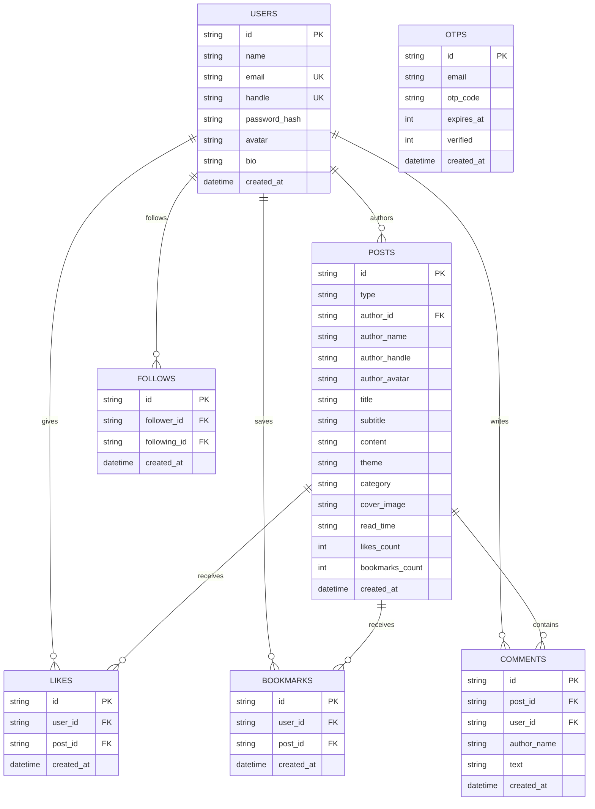

# ✦ READORA (Redora)

<div align="center">

  

  <br />
  <br />

  <h1>📖 Where Readers Become Creators</h1>

  <p align="center">
    <strong>A high-performance, dark crimson social publishing platform bridging micro-thought reflections and deep long-form literature.</strong>
  </p>

  <p align="center">
    <a href="#key-features">Features</a> •
    <a href="#tech-stack">Tech Stack</a> •
    <a href="#quick-start">Quick Start</a> •
    <a href="#api-documentation">API Reference</a> •
    <a href="#database-schema">Database Schema</a> •
    <a href="#deployment">Deployment</a> •
    <a href="#license">License</a>
  </p>

  <p align="center">
    
    
    
    
    
    
  </p>
</div>

---

## 🌟 Overview

**READORA** (also known as *Redora*) was conceived for writers, developers, philosophers, and thinkers who desire a quiet, intentional digital sanctuary. In an era dominated by fleeting algorithms and superficial feeds, READORA combines the rapid intimacy of **Instagram-style short thoughts** with the intellectual depth of **Medium-style long-form essays**.

Every statistic, post count, like, bookmark, comment, and social follow is powered by a real, hardened SQLite backend—eliminating fake mock data in favor of a true, database-driven community.

---

## ✨ Key Features

### 🛡️ Authentication & Identity Security
- **Multi-Step Email OTP Verification:** Strict RFC 5322 regex checks, fake/disposable domain filtering, and real-time DNS MX record resolution before dispatching secure 6-digit one-time passcodes via Nodemailer.
- **Live Handle Availability Engine:** Realtime asynchronous username verification (`@handle`) with strict debounce and format validation.
- **Flexible Identifier Login:** Seamless sign-in accepting email, clean username (`username`), or full handle (`@username`).
- **Encrypted Password Storage:** Industry-standard **bcrypt** password hashing with 10 salt rounds.
- **Stateless JWT Sessions:** Cryptographically signed tokens with automatic client expiration handling.

### 💭 Micro-Thought Composer
- **Instagram-Style Thought Cards:** Share rapid reflections, poetry, epiphanies, and quotes.
- **5 Gradient Aesthetic Themes:** Choose between *Crimson Fire*, *Midnight Cosmos*, *Amber Glow*, *Emerald Mystic*, and *Classic Minimal*.
- **Topic Categorization:** Tag posts with topics like *Tech*, *Philosophy*, *Creative*, *Life Lessons*, or *General*.

### 📖 Immersive Long-Form Publishing
- **Distraction-Free Editor:** Publish structured essays with customizable cover imagery, titles, subtitles, and markdown content.
- **Automatic Read-Time Computation:** Dynamic calculation based on average human cognitive reading pace (180 wpm).
- **Full Reading Modal:** Immersive typography designed with high-contrast serif formatting for prolonged focus.

### 🤝 Social Graph & Reader Engagement
- **Toggle Likes & Bookmarks:** Real-time engagement counters with persistent state per user.
- **Threaded Comments:** Interactive discussions below publications with author attributions.
- **Creator Follow System:** Real follower/following social graph with live follower metrics.
- **Author Ownership Protection:** Strict cryptographic ownership checks on post edits and deletions (HTTP 403 prevention for unauthorized actions, cascading removal of likes/comments/bookmarks on deletion).

### 📊 Real Database Analytics
- **Live Community Stats:** Real-time metrics for active creators, published thoughts, and articles directly queried from SQLite.
- **Trending Topics Algorithm:** Real-time categorization grouping publications by tag frequency.
- **Featured Creators Spotlight:** Dynamic creator recommendations ordered by community engagement and follower count.

---

## 🛠️ Tech Stack

| Layer | Technology | Details |
| :--- | :--- | :--- |
| **Frontend** | HTML5, CSS3, Vanilla ES6+ | Glassmorphism UI, Responsive CSS Grid/Flexbox, Zero bulky bundle dependencies |
| **Backend** | Node.js, Express.js | RESTful routing, modular middleware architecture, centralized error handling |
| **Database** | SQLite3 | Native promise wrappers (`db.getAsync`, `db.allAsync`, `db.runAsync`), relational foreign keys |
| **Authentication** | JWT & bcryptjs | Stateless authorization headers, salted password hashes |
| **Email Service** | Nodemailer | Gmail SMTP integration for OTP delivery |
| **DNS Validation** | Node.js `dns.promises` | Live MX record verification against disposable domains |

---

## 📁 Repository Structure

```
readora/
├── db/
│   └── database.js          # SQLite connection, Promise wrappers & auto-migration engine
├── middleware/
│   └── authMiddleware.js    # JWT verification & optional auth extractors
├── routes/
│   ├── auth.js              # Signup, OTP verification, login & profile endpoints
│   └── posts.js             # Thoughts, articles, likes, bookmarks, comments & stats
├── utils/
│   └── mailer.js            # Nodemailer transport & HTML verification templates
├── account.html             # Multi-step OTP registration UI
├── app.js                   # Client-side core application controller
├── DEPLOYMENT_GUIDE.md      # Comprehensive production deployment walkthrough
├── index.html               # Main platform feed, composer, modals & widgets
├── package.json             # Project dependencies & startup scripts
├── practise.html            # Sign-in & guest access portal
├── Procfile                 # Production web process definition
├── render.yaml              # Render Cloud deployment blueprint
├── style.css                # Dark crimson aesthetic design system
├── .env.example             # Clean environment variable template
└── .gitignore               # Excludes secrets, databases, logs, and dependencies
```

---

## 🚀 Quick Start

### 1. Prerequisites
- **Node.js** (v18.0.0 or higher recommended)
- **npm** (bundled with Node.js)
- **Git**

### 2. Clone the Repository
```bash
git clone https://github.com/Harshbansal906/readora.git
cd readora
```

### 3. Install Dependencies
```bash
npm install
```

### 4. Configure Environment Variables
Copy the example environment configuration:
```bash
cp .env.example .env
```

Edit `.env` with your credentials:
```env
PORT=5000
NODE_ENV=development
JWT_SECRET=your_super_secret_jwt_key
DB_PATH=./readora.db

# Email OTP Service (Optional for development / Required for production)
GMAIL_USER=your_email@gmail.com
GMAIL_APP_PASS=your_16_character_app_password
FROM_EMAIL="READORA Team" <your_email@gmail.com>
```

> **Note:** To generate a 16-character Gmail App Password, visit: [Google Account App Passwords](https://myaccount.google.com/apppasswords).

### 5. Start the Server
```bash
npm start
```

Open your browser and navigate to:
```
http://localhost:5000
```

---

## 📡 API Reference

### Authentication Endpoints (`/api/auth`)

| Method | Endpoint | Auth | Description |
| :--- | :--- | :---: | :--- |
| `POST` | `/api/auth/send-otp` | ❌ | Validate domain, generate 6-digit OTP, send email |
| `GET` | `/api/auth/check-username` | ❌ | Check handle availability (`?handle=@name`) |
| `POST` | `/api/auth/verify-otp` | ❌ | Validate 6-digit code, return temporary session token |
| `POST` | `/api/auth/complete-signup` | ❌ | Set password and create verified creator account |
| `POST` | `/api/auth/login` | ❌ | Authenticate with email or username & return JWT |
| `GET` | `/api/auth/me` | 🔒 | Get current user profile with live post/follower metrics |
| `PUT` | `/api/auth/profile` | 🔒 | Update user name, bio, and avatar initials |

### Publications & Engagement Endpoints (`/api/posts`)

| Method | Endpoint | Auth | Description |
| :--- | :--- | :---: | :--- |
| `GET` | `/api/posts` | Optional | Stream posts with search, category & saved filters |
| `POST` | `/api/posts/thought` | 🔒 | Publish aesthetic short thought card |
| `POST` | `/api/posts/article` | 🔒 | Publish long-form article with cover image & read-time |
| `PUT` | `/api/posts/:id` | 🔒 | Edit thought or article (Author only) |
| `DELETE`| `/api/posts/:id` | 🔒 | Delete post with cascading cleanup (Author only) |
| `POST` | `/api/posts/:id/like` | Optional | Toggle like status on publication |
| `POST` | `/api/posts/:id/bookmark` | Optional | Toggle bookmark status for user |
| `POST` | `/api/posts/:id/comment` | Optional | Add a comment to a publication |
| `GET` | `/api/posts/community-stats`| ❌ | Fetch live counts for creators, thoughts, articles |
| `GET` | `/api/posts/trending-topics` | ❌ | Top publication topics grouped by frequency |
| `GET` | `/api/posts/featured-creators`| Optional | Discover creators ranked by followers & activity |
| `POST` | `/api/posts/follow/:userId` | 🔒 | Follow or unfollow another creator |

---

## 🗄️ Database Schema

The database utilizes SQLite3 with normalized tables:



---

## 🧪 Testing & Verification

READORA includes an automated end-to-end integration test suite verifying authentication, authorization, CRUD operations, database cascade deletions, and SQL injection security:

```bash
node test_audit.js
```

**Audit Results:**
- ✅ **37/37 Integration Tests Passing (100% Success Rate)**
- ✅ Injection immunity verified across input search parameters
- ✅ Strict author ownership verified on content modifications
- ✅ Email MX syntax validation & OTP expiration lifecycle confirmed

---

## 🌐 Deployment to Cloud

### 1-Click Deployment on Render
1. Push this repository to your GitHub account.
2. Sign in to [Render.com](https://render.com) and create a **New Web Service**.
3. Select your `readora` repository.
4. Settings:
   - **Environment:** `Node`
   - **Build Command:** `npm install`
   - **Start Command:** `npm start`
5. Add your environment variables (`JWT_SECRET`, `GMAIL_USER`, `GMAIL_APP_PASS`).
6. Deploy! Render automatically provisions a free SSL certificate (`https://`).

For custom domain instructions (e.g. `readora.app`), refer to [`DEPLOYMENT_GUIDE.md`](./DEPLOYMENT_GUIDE.md).

---

## 👨‍💻 Author

**Harsh Bansal**
- GitHub: [@Harshbansal906](https://github.com/Harshbansal906)
- Project: [READORA (Redora)](https://github.com/Harshbansal906/readora)

---

## 📄 License

This project is licensed under the **MIT License** - see the [LICENSE](LICENSE) file for details.
