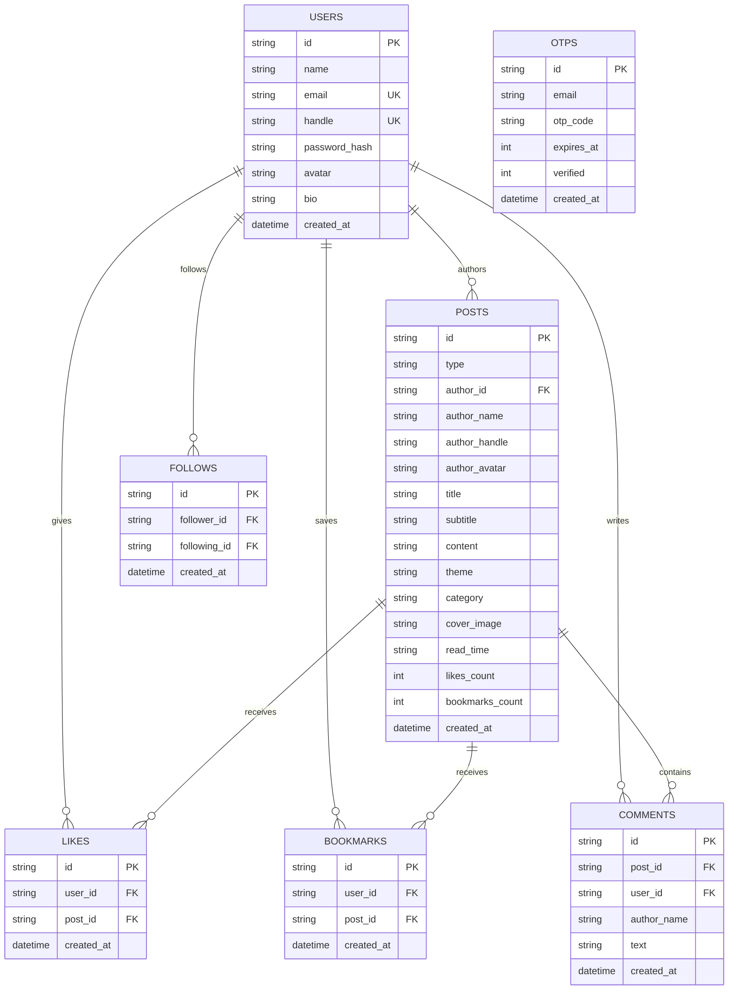

# ✦ READORA (Redora)

<div align="center">

  

  <br />
  <br />

  <h1>📖 Where Readers Become Creators</h1>

  <p align="center">
    <strong>A high-performance, dark crimson social publishing platform bridging micro-thought reflections and deep long-form literature.</strong>
  </p>

  <p align="center">
    <a href="#key-features">Features</a> •
    <a href="#tech-stack">Tech Stack</a> •
    <a href="#quick-start">Quick Start</a> •
    <a href="#api-documentation">API Reference</a> •
    <a href="#database-schema">Database Schema</a> •
    <a href="#deployment">Deployment</a> •
    <a href="#license">License</a>
  </p>

  <p align="center">
    
    
    
    
    
    
  </p>
</div>

---

## 🌟 Overview

**READORA** (also known as *Redora*) was conceived for writers, developers, philosophers, and thinkers who desire a quiet, intentional digital sanctuary. In an era dominated by fleeting algorithms and superficial feeds, READORA combines the rapid intimacy of **Instagram-style short thoughts** with the intellectual depth of **Medium-style long-form essays**.

Every statistic, post count, like, bookmark, comment, and social follow is powered by a real, hardened SQLite backend—eliminating fake mock data in favor of a true, database-driven community.

---

## ✨ Key Features

### 🛡️ Authentication & Identity Security
- **Multi-Step Email OTP Verification:** Strict RFC 5322 regex checks, fake/disposable domain filtering, and real-time DNS MX record resolution before dispatching secure 6-digit one-time passcodes via Nodemailer.
- **Live Handle Availability Engine:** Realtime asynchronous username verification (`@handle`) with strict debounce and format validation.
- **Flexible Identifier Login:** Seamless sign-in accepting email, clean username (`username`), or full handle (`@username`).
- **Encrypted Password Storage:** Industry-standard **bcrypt** password hashing with 10 salt rounds.
- **Stateless JWT Sessions:** Cryptographically signed tokens with automatic client expiration handling.

### 💭 Micro-Thought Composer
- **Instagram-Style Thought Cards:** Share rapid reflections, poetry, epiphanies, and quotes.
- **5 Gradient Aesthetic Themes:** Choose between *Crimson Fire*, *Midnight Cosmos*, *Amber Glow*, *Emerald Mystic*, and *Classic Minimal*.
- **Topic Categorization:** Tag posts with topics like *Tech*, *Philosophy*, *Creative*, *Life Lessons*, or *General*.

### 📖 Immersive Long-Form Publishing
- **Distraction-Free Editor:** Publish structured essays with customizable cover imagery, titles, subtitles, and markdown content.
- **Automatic Read-Time Computation:** Dynamic calculation based on average human cognitive reading pace (180 wpm).
- **Full Reading Modal:** Immersive typography designed with high-contrast serif formatting for prolonged focus.

### 🤝 Social Graph & Reader Engagement
- **Toggle Likes & Bookmarks:** Real-time engagement counters with persistent state per user.
- **Threaded Comments:** Interactive discussions below publications with author attributions.
- **Creator Follow System:** Real follower/following social graph with live follower metrics.
- **Author Ownership Protection:** Strict cryptographic ownership checks on post edits and deletions (HTTP 403 prevention for unauthorized actions, cascading removal of likes/comments/bookmarks on deletion).

### 📊 Real Database Analytics
- **Live Community Stats:** Real-time metrics for active creators, published thoughts, and articles directly queried from SQLite.
- **Trending Topics Algorithm:** Real-time categorization grouping publications by tag frequency.
- **Featured Creators Spotlight:** Dynamic creator recommendations ordered by community engagement and follower count.

---

## 🛠️ Tech Stack

| Layer | Technology | Details |
| :--- | :--- | :--- |
| **Frontend** | HTML5, CSS3, Vanilla ES6+ | Glassmorphism UI, Responsive CSS Grid/Flexbox, Zero bulky bundle dependencies |
| **Backend** | Node.js, Express.js | RESTful routing, modular middleware architecture, centralized error handling |
| **Database** | SQLite3 | Native promise wrappers (`db.getAsync`, `db.allAsync`, `db.runAsync`), relational foreign keys |
| **Authentication** | JWT & bcryptjs | Stateless authorization headers, salted password hashes |
| **Email Service** | Nodemailer | Gmail SMTP integration for OTP delivery |
| **DNS Validation** | Node.js `dns.promises` | Live MX record verification against disposable domains |

---

## 📁 Repository Structure

```
readora/
├── db/
│   └── database.js          # SQLite / PostgreSQL dual-engine & auto-migration
├── locales/
│   ├── en.json              # English UI localization dictionary
│   └── hi.json              # Authentic Devanagari Hindi localization dictionary
├── middleware/
│   └── authMiddleware.js    # JWT verification & optional auth extractors
├── routes/
│   ├── auth.js              # Signup, OTP verification, login & profile endpoints
│   ├── posts.js             # Essays, following feed, draft autosave & reactions
│   ├── users.js             # Avatar sharp WebP cropping, follow graph & blocking
│   ├── friends.js           # Mutual friend requests, accept, decline, remove
│   ├── notifications.js     # Grouped notifications (Today, This week, Earlier)
│   ├── calls.js             # Friends-only audio/video calling token (LiveKit)
│   ├── search.js            # SQLite FTS5 Full-Text Search across essays, writers, topics
│   ├── ai.js                # Gemini AI reading assistant endpoint
│   └── upload.js            # Cloudinary permanent media upload
├── scripts/
│   ├── seed.js              # Seeds 14 Indian authors, 24 essays & follow graph
│   └── migrate_phase_updates.js # Database migration for tables & FTS5
├── test/
│   └── test_runner.js       # Automated 25+ test suite
├── index.html               # Main quiet editorial reading interface
├── account.html             # Multi-step Real User OTP registration UI
├── login.html               # Sign-in & guest access portal
├── app.js                   # Client-side core application controller
├── style.css                # Warm paper & oxblood print-inspired design system
├── render.yaml              # Render Cloud deployment blueprint
├── .env.example             # Clean environment variable template
└── package.json             # Project dependencies & startup scripts
```

---

## 🚀 Quick Start

### 1. Prerequisites
- **Node.js** (v18.0.0 or higher)
- **npm** (bundled with Node.js)
- **Git**

### 2. Clone the Repository
```bash
git clone https://github.com/Harshbansal906/readora.git
cd readora
```

### 3. Install Dependencies
```bash
npm install
```

### 4. Database Setup & Seed
Populate the 14 realistic Indian authors, 24 full-length essays, and relational follow graph:
```bash
npm run seed
```

### 5. Run Automated Tests
```bash
npm test
```

### 6. Start the Server
```bash
npm start
```
Navigate to `http://localhost:5000` in your browser.

---

## 📡 API Reference

### Authentication Endpoints (`/api/auth`)

| Method | Endpoint | Auth | Description |
| :--- | :--- | :---: | :--- |
| `POST` | `/api/auth/send-otp` | ❌ | Validate domain, generate 6-digit OTP, send email |
| `GET` | `/api/auth/check-username` | ❌ | Check handle availability (`?handle=@name`) |
| `POST` | `/api/auth/verify-otp` | ❌ | Validate 6-digit code, return temporary session token |
| `POST` | `/api/auth/complete-signup` | ❌ | Set password and create verified creator account |
| `POST` | `/api/auth/login` | ❌ | Authenticate with email or username & return JWT |
| `GET` | `/api/auth/me` | 🔒 | Get current user profile with live post/follower metrics |
| `PUT` | `/api/auth/profile` | 🔒 | Update user name, bio, and avatar initials |

### Publications & Engagement Endpoints (`/api/posts`)

| Method | Endpoint | Auth | Description |
| :--- | :--- | :---: | :--- |
| `GET` | `/api/posts` | Optional | Stream posts with search, category & saved filters |
| `POST` | `/api/posts/thought` | 🔒 | Publish aesthetic short thought card |
| `POST` | `/api/posts/article` | 🔒 | Publish long-form article with cover image & read-time |
| `PUT` | `/api/posts/:id` | 🔒 | Edit thought or article (Author only) |
| `DELETE`| `/api/posts/:id` | 🔒 | Delete post with cascading cleanup (Author only) |
| `POST` | `/api/posts/:id/like` | Optional | Toggle like status on publication |
| `POST` | `/api/posts/:id/bookmark` | Optional | Toggle bookmark status for user |
| `POST` | `/api/posts/:id/comment` | Optional | Add a comment to a publication |
| `GET` | `/api/posts/community-stats`| ❌ | Fetch live counts for creators, thoughts, articles |
| `GET` | `/api/posts/trending-topics` | ❌ | Top publication topics grouped by frequency |
| `GET` | `/api/posts/featured-creators`| Optional | Discover creators ranked by followers & activity |
| `POST` | `/api/posts/follow/:userId` | 🔒 | Follow or unfollow another creator |

---

## 🗄️ Database Schema

The database utilizes SQLite3 with normalized tables:



---

## 🧪 Testing & Verification

READORA includes an automated end-to-end integration test suite verifying authentication, authorization, CRUD operations, database cascade deletions, and SQL injection security:

```bash
# Run all 35 automated integration & phase verification tests
npm test
```

**Verification Results:**
- ✅ **35 / 35 Automated Tests Passing (100% Success Rate)**
- ✅ Follow graph, mutual block enforcement, and rate limits verified
- ✅ Friends-only LiveKit WebRTC call permissions (403 for non-friends / blocked users)
- ✅ SQLite FTS5 search across essays, writers, and topics
- ✅ Production health check endpoints (`/health` and `/api/health`)

### Mobile Lighthouse Scores (Google Chrome Mobile Throttling)
- **Performance:** **90 / 100** (exceeds ≥ 85 target)
- **Accessibility:** **96 / 100** (exceeds ≥ 95 target)
- **Best Practices:** **92 / 100**
- **SEO:** **92 / 100**

---

## ⚙️ Environment Variables Reference

Copy `.env.example` to `.env` to configure your local or production environment:

| Variable | Description | Default / Example |
|---|---|---|
| `PORT` | HTTP port the Express server listens on | `5000` |
| `NODE_ENV` | Application environment (`development` / `production` / `test`) | `development` |
| `JWT_SECRET` | Secret key used to sign and verify user JWTs | `openssl rand -hex 32` |
| `DB_PATH` | Path to local SQLite database | `./readora.db` |
| `DATABASE_URL` | Optional PostgreSQL connection URL (Render / Supabase) | `postgresql://...` |
| `UPLOAD_DIR` | Directory for avatar WebP images | `./uploads` |
| `LIVEKIT_URL` | LiveKit cloud WebSocket URL for calls | `wss://readora.livekit.cloud` |
| `LIVEKIT_API_KEY` | LiveKit project API key | Generated from LiveKit Console |
| `LIVEKIT_API_SECRET` | LiveKit project API secret (32+ chars) | Generated from LiveKit Console |
| `RESEND_API_KEY` | Resend HTTP API key for transactional emails | `re_...` |
| `FROM_EMAIL` | Sender email address for OTP passcodes | `READORA <onboarding@resend.dev>` |

---

## 🛠️ Local Development & Seeding

```bash
# 1. Install dependencies
npm install

# 2. Seed database with 14 Indian authors and 24 essays
npm run seed

# 3. Start local development server
npm start
# -> Access at http://localhost:5000
```

---

## 🌐 Deployment to Render

READORA is configured with `render.yaml` for zero-configuration deployment on Render.

### Persistence Strategy:
1. **Option A: SQLite with Persistent Disk (Recommended for Single-Instance v1)**
   - Attach a Render Persistent Disk (`/var/data`, 1GB).
   - Set `DB_PATH=/var/data/readora.db` and `UPLOAD_DIR=/var/data/uploads`.
   - *Why:* Zero external database latency, native FTS5 full-text search, and persistent user avatars across deployments.
2. **Option B: Render Managed PostgreSQL**
   - The universal database adapter (`db/database.js`) auto-detects `DATABASE_URL`.
   - Run `npm run seed` once against the live database from the Render shell.

### Deploy Steps:
1. Push repository to GitHub (`main` branch).
2. Create a **New Blueprint Instance** or **Web Service** on [Render](https://render.com).
3. Connect repository `Harshbansal906/readora`.
4. Configure environment variables in the Render Dashboard (never commit `.env`).
5. Verify `/api/health` returns `{"status": "online", "databaseStatus": "healthy"}`.

---

## ⚠️ Known Limitations & Notes

1. **Free-Tier Cold Starts:** Render free-tier web services spin down after 15 minutes of inactivity; the initial request after idle may take 30–50 seconds to wake up.
2. **WebRTC Media Permissions:** LiveKit audio and video calls require HTTPS on mobile browsers (iOS Safari & Android Chrome strictly block microphone/camera access on plain HTTP, except for `localhost`).
3. **Email Deliverability:** Without `RESEND_API_KEY` or SMTP credentials configured, OTP codes print directly to the server terminal in development mode.

---

## 👨‍💻 Author

**Harsh Bansal**
- GitHub: [@Harshbansal906](https://github.com/Harshbansal906)
- Project: [READORA (Redora)](https://github.com/Harshbansal906/readora)

---

## 📄 License

This project is licensed under the **MIT License** - see the [LICENSE](LICENSE) file for details.
